# turkce-ai-karnesi

<p align="center"></p>

Türkçe'de gerçekten iş gören LLM'leri ölçen bir değerlendirme kiti — özellikle
insanların fiilen kullandığı ucuz/ücretsiz modeller için.

73 özgün görev (veri seti v1, CC-BY-4.0) 8 kategoride: resmi yazı/dilekçe,
e-posta, özet, dağınık belgeden alan çıkartımı (fatura/tutanak — 11'i tohumlu
OCR gürültüsüyle üretilmiş), imla kuralları (de/da, ki, soru eki), yönerge
takibi, TR↔EN çeviri, akıl yürütme.

## Hızlı başlangıç

```bash
pip install -e .
export KARNE_BASE_URL=...   # OpenAI-uyumlu herhangi bir uç
export KARNE_API_KEY=...
export KARNE_MODEL=...

karne run --model $KARNE_MODEL --html
```

Sonuç: `results/` altında JSON + statik HTML karnesi (kategori bazlı grafik
dahil). Her görev deterministik kontrollerle (içerme, satır yapısı, JSON
alan doğruluğu, kelime/cümle sayısı, Türkçe oranı, `spelling_rules` ile
TDK imla taraması) puanlanır — aynı uç + aynı veri seti = aynı puan.

İsteğe bağlı ikinci bir model sabit bir rubrikle jüri olabilir:
`karne run --model X --judge-model Y` (ağırlık `--judge-weight`, varsayılan
0,4; `--judge-runs N` ile her çıktı N kez puanlanıp ölçüt bazında medyan
alınır — tek puanlık sapmayı azaltır). İki koşuyu karşılaştırmak için:
`karne compare a.json b.json` — görev bazında fark, iyileşme/gerileme,
McNemar anlamlılık testi ve ortalama fark için eşleştirilmiş bootstrap
%95 güven aralığı (`delta_ci95`); `--checks` kontrol bazında geçme/kalma
değişimlerini de listeler. Üç veya daha fazla dosya verilirse
(`karne compare taban.json b.json c.json`) her koşu ilk dosyayla
eşleştirilir: önce eşleştirilmiş ortalama puana göre bir sıralama tablosu,
ardından her çift için tam karşılaştırma çıktısı gelir.
İstem stili değiştirilebilir: `--prompt-style zero|fewshot|cot`. Kararlılığı
ölçmek için `--repeat N` her görevi N kez gerçekten üretir; özet, tekrarlar
arasında sonucu değişen görevleri `rep_unstable` olarak listeler ve
`score_worst_rep`/`score_best_rep` ile dağılımı sınırlar. `summary.ci95`
ana puana tohumu veriden türetilen küme-bootstrap %95 güven aralığı
ekler; `karne report --format md` Markdown karne tablosu üretir.
Kontrol türü kırılımı da görünür: koşu özetinde `by_check_type` (kontrol
bazında ortalama puan + başarısız sayısı) tutulur ve HTML/Markdown
karnesinde "en çok hangi kontrol türü düşüyor" tablosu en kötü önde
olacak şekilde gösterilir.
`--best` verilirse dosya sırası yerine en yüksek puanlı koşu taban olur.

## Sonuçlar (Ekim 2026)

Veri seti v1'in 73 görevinin tamamı (sha256 `d32efc57324a…`), 2026-10-19:
sıfır örnekli (zero-shot), varsayılan sistem istemi, görev başına tek
üretim, yalnızca deterministik kontroller (jüri yok).

| Model | Genel | %95 GA | En iyi kategori | En zayıf kategori |
|---|---:|---:|---|---|
| GLM-5.3 (Z.ai) | **%94,8** | 91,5–97,6 | `akl-yurutme` %100 | `resmi-yazi` %80 |
| Nemotron-3.5-Super-VL (NVIDIA) | %94,2 | 90,4–97,4 | `akl-yurutme` %100 | `imla` %83 |
| DeepSeek-V4.1-Flash | %94,1 | 90,9–96,6 | `akl-yurutme` %100 | `resmi-yazi` %83 |
| MiMo-V2.6-Flash (Xiaomi) | %90,4 | 85,2–94,3 | `akl-yurutme` %100 | `imla` %76 |
| GLM-5.3-Flash (Z.ai) | %87,3 | 81,7–92,3 | `ceviri` %99 | `imla` %63 |
| Ling-3.1-Flash (inclusionAI) | %85,4 | 78,1–91,8 | `akl-yurutme` %100 | `imla` %33 |

İlk üç model güven aralıkları içinde örtüşüyor — fiilen berabere. Küçük
ve hızlı modeller en çok `imla`da (de/da, ki, soru eki, bitişik yazım)
düşüyor; `resmi-yazi` (dilekçe düzeni) en güçlü modellerde bile zayıf
nokta. Tam karne: [`docs/results/2026-10/scorecard.md`](docs/results/2026-10/scorecard.md)
ve yanıtların tamamıyla HTML: [`docs/results/2026-10/scorecard.html`](docs/results/2026-10/scorecard.html).

## Lisans

Kod MIT (`LICENSE`); veri seti (`dataset/` altı) CC-BY-4.0
(`dataset/LICENSE.md`). Katkı için `CONTRIBUTING.md`: göndermeden önce
yerelde `pytest` ve `karne validate` çalıştırın (barındırılan CI yok).

Detaylar ve veri seti şeması için: [`README.md`](README.md)
